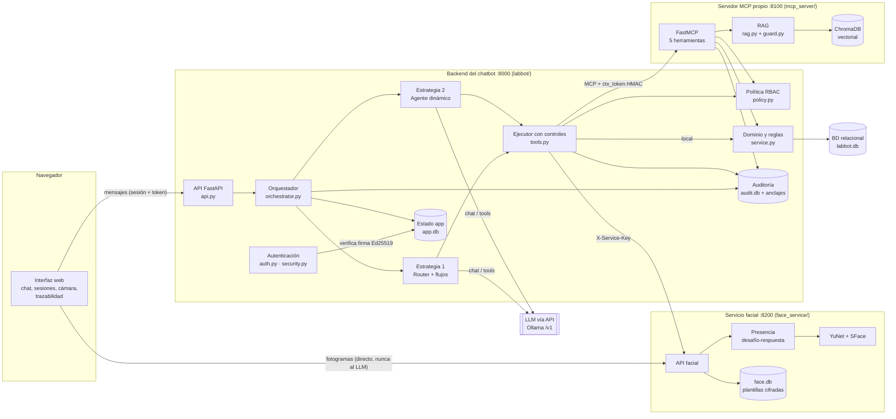
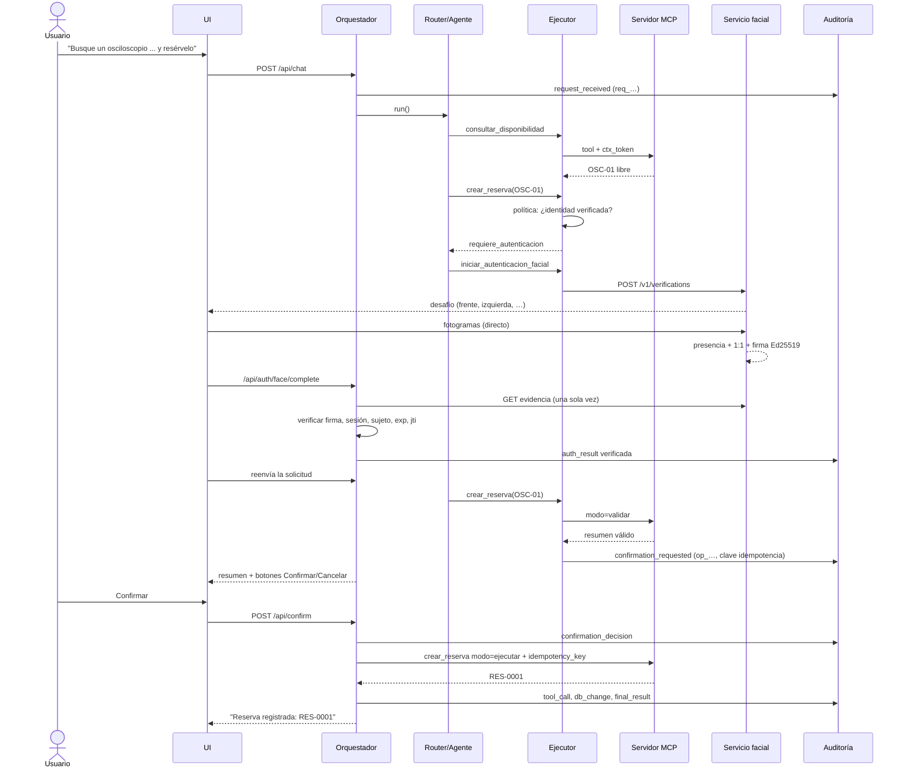

# Arquitectura de LabBot

## 1. Diagrama de componentes

Tres procesos independientes (backend, servidor MCP, servicio facial) más el LLM. La BD de
operaciones, la de estado de la aplicación, la de auditoría y la biométrica son archivos
distintos: la caída de uno no arrastra a los demás (escenario D) y los datos biométricos
quedan aislados en el servicio facial.

## 2. Responsabilidades de cada componente

| Componente | Responsabilidad | Por qué así |
|---|---|---|
| **Interfaz web** (`labbot/static`) | Declarar identidad, conversar, gestionar sesiones e historial, mostrar confirmaciones, abrir la cámara, formulario del código alternativo, ver la traza de cada solicitud, inyectar fallos (demo). | Las confirmaciones y los secretos (código TOTP, imágenes) no pasan por el texto del chat. |
| **API** (`api.py`) | Autentica la *sesión* (id + token cuyo hash se guarda), expone chat, confirmación, autenticación, auditoría y demo. | Frontera HTTP delgada; la lógica está en el orquestador. |
| **Orquestador** (`orchestrator.py`) | Asigna `request_id`, registra solicitud y resultado, decide si un mensaje es una confirmación (regla determinista o botón), ejecuta lo confirmado con idempotencia, reintentos y reconciliación, valida citas y la veracidad de la respuesta. | Concentra lo que no se puede delegar al LLM: estado, autorización final y verdad de lo ocurrido. |
| **Router** (`router.py`) | Clasifica la intención (JSON validado), extrae parámetros (LLM + analizador determinista) y ejecuta un flujo fijo por ruta. | Predecible y barato; sirve de línea base para comparar. |
| **Agente** (`agent.py`) | Bucle de *function calling*: el LLM elige herramientas paso a paso (máx. 6). | Flexible para solicitudes de varios pasos; más costoso. |
| **Ejecutor** (`tools.py`) | Tubería única de cada herramienta: esquema de entrada → política → confirmación (escrituras) → ejecución local/MCP con reintentos → esquema de salida → auditoría. | Ambas estrategias comparten exactamente los mismos controles. |
| **Política** (`policy.py`) | Matriz rol→herramientas, identidad verificada obligatoria, reglas de alcance (propio vs. ajeno). | La autorización está en código, nunca en el prompt. |
| **Dominio** (`service.py`) | Reglas de negocio del reglamento (horario, duración, anticipación, inducción, sanciones, mantenimiento, superposición, límites), transacciones `BEGIN IMMEDIATE`, idempotencia. | Vuelve a comprobar permisos (defensa en profundidad) y serializa escrituras concurrentes. |
| **Servidor MCP** (`mcp_server/server.py`) | Expone 5 herramientas por Streamable HTTP; exige `ctx_token` HMAC y reaplica la política. | Separa herramientas reutilizables; una llamada MCP directa sin contexto válido se rechaza. |
| **RAG** (`rag.py`, `guard.py`) | Fragmenta por artículo, indexa en ChromaDB, recupera top-k y pone en cuarentena fragmentos con instrucciones al asistente. | La cita es el id del fragmento (`REG-LAB-001#art3`), verificable contra lo recuperado. |
| **Autenticación** (`auth.py`, `security.py`) | Cliente del servicio facial; verifica la evidencia Ed25519 (sesión, sujeto, vencimiento, jti único); TOTP alternativo; tickets de enrolamiento. | El backend puede verificar pero no fabricar evidencias; el LLM no participa. |
| **Servicio facial** (`face_service/`) | Enrolamiento con consentimiento, verificación 1:1 con desafío de poses, plantillas cifradas, eliminación, bloqueo tras 3 fallos, emisión de evidencia firmada. | Servicio independiente: las imágenes y plantillas nunca salen de él. |
| **Auditoría** (`audit.py`) | Registro de solo adición con cadena HMAC, anclajes externos, verificación, consulta y exportación sin biometría. | Permite reconstruir cada operación y detectar alteraciones. |

## 3. Flujos

### 3.1 Solicitud de varios pasos (escenario B)

### 3.2 Operación no autorizada (escenario C)
El estudiante pide cancelar `RES-0001`, que es de otra persona. La política de roles permite a
un estudiante usar `cancelar_reserva`, así que la llamada llega al dominio (en el servidor MCP),
que compara titular y actor y devuelve `RESERVA_DE_OTRO`. El ejecutor registra `authz_denied`
con el actor, la reserva y el motivo; no se crea operación pendiente; la respuesta cita la regla.

### 3.3 Fallo parcial (escenario D)
- **Servicio caído antes de ejecutar**: lecturas con 3 reintentos (0,2 s, 0,5 s); si persisten,
  `servicio_no_disponible` y "no se realizó ningún cambio".
- **Servicio caído al confirmar**: 3 intentos con la *misma* clave de idempotencia; después,
  reconciliación consultando la tabla `idempotency` en la BD:
  - la clave existe → la operación sí se hizo (respuesta perdida): se informa como realizada, sin duplicar;
  - no existe y la BD responde → "NO se registró"; la operación queda pendiente para reintentar;
  - la BD tampoco responde → estado desconocido: "NO la dé por realizada".
- **Filtro de veracidad**: si el texto del LLM afirma una operación o autenticación que el
  sistema no registró, se reemplaza y se registra `truth_guard`.

### 3.4 Conflicto concurrente (escenario E)
Las dos confirmaciones llegan al dominio, que abre `BEGIN IMMEDIATE`. SQLite concede el
bloqueo de escritura a una; la otra espera, vuelve a comprobar superposiciones dentro de su
transacción, encuentra la reserva recién creada y falla con `CONFLICTO_HORARIO`. Solo una se confirma.

### 3.5 Manipulación (escenario F)
- **Del usuario**: `guard.scan` marca el mensaje (`input_screening`), pero no le da ningún
  privilegio: autenticación, rol, propiedad y confirmación los comprueba el backend.
- **De un documento**: el fragmento `FORO-EST-007#sec2` contiene instrucciones; se pone en
  cuarentena y no se entrega al LLM. Aunque llegara, el LLM no puede autenticar a nadie
  (solo una firma Ed25519 lo hace), no puede confirmar (la confirmación la decide el
  orquestador sobre el mensaje del usuario o el botón) y no puede actuar por otro usuario
  (la identidad viaja en el `ctx_token`, no en los argumentos).

## 4. Interacciones justificadas

1. **Identidad fuera de los argumentos del LLM.** Ningún esquema de herramienta tiene un campo
   "actor". El orquestador añade el `ctx_token` firmado; el MCP lo verifica. Así, una inyección
   no puede hacer que el LLM actúe "como" otra persona.
2. **Escritura en dos fases (validar → confirmar → ejecutar).** El resumen se valida contra
   el dominio antes de mostrarlo, y la ejecución vuelve a validar todo dentro de la transacción
   (el estado puede haber cambiado, como en E04).
3. **Idempotencia por operación pendiente.** La clave se crea con la operación pendiente; los
   reintentos del orquestador, un doble clic o la reconfirmación tras un fallo reutilizan la clave.
4. **Evidencia facial asimétrica.** El servicio facial firma con su clave privada; el backend
   solo tiene la pública. Un backend comprometido o un LLM no pueden fabricar una autenticación.
5. **Auditoría separada.** Va en su propio archivo para registrar el fallo cuando la BD de
   operaciones cae, y se ancla externamente para detectar truncamientos.
